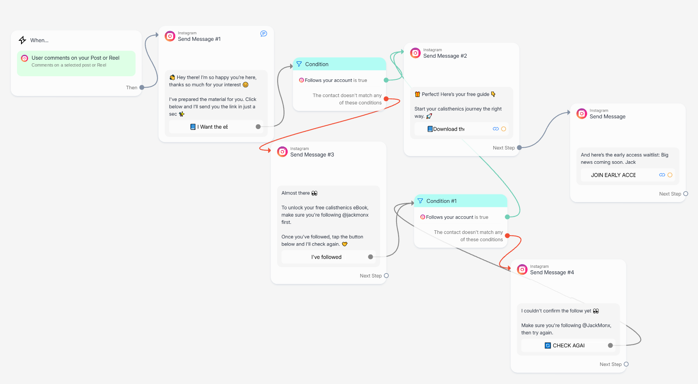
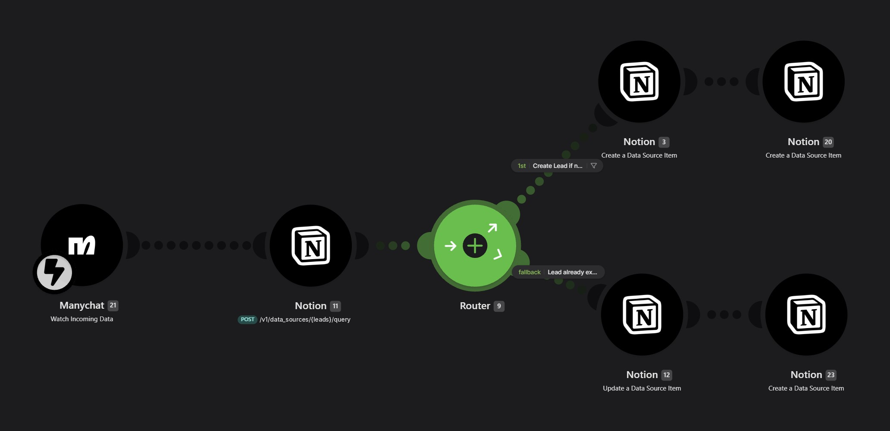
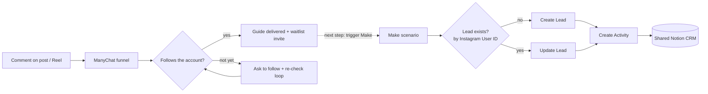

# Jackmonx — Instagram-to-CRM Growth Engine

**GTM Engineering case study: turning Instagram comments into followers, resource deliveries and CRM-ready leads.**

`Instagram` · `ManyChat` · `Make` · `Notion API` · `Conversational automation` · `CRM data model`

> **Status:** conversational funnel live on Instagram · CRM sync built and tested · connecting the two is the next step.
> No performance metrics are claimed: volumes are still early-stage.

---

## Context

Jackmonx is my calisthenics brand on Instagram. Its acquisition asset is a free, multilingual calisthenics eBook.

The goal of this system is to turn a single comment into four outcomes:

1. **a conversation** in the DMs,
2. **a follower** for the account,
3. **a delivered resource** and an invitation to the early-access waitlist,
4. **a CRM record** that remembers which content brought the person in.

## The problem

- Replying by hand to every comment does not scale, and most commenters drop off before a conversation starts.
- A free resource given away with nothing in return does not grow the audience.
- Without a CRM record, engagement cannot be attributed to a piece of content, followed up, or connected to what the same person later does on the website.

## What I built

The system has two components.

### 1. Conversational funnel — ManyChat (live)

*Live ManyChat flow. Delivery and click metrics hidden: volumes are too small to be meaningful.*

| Step | What happens |
|---|---|
| **Trigger** | Someone comments on a selected post or Reel (keyword filter configurable). |
| **Public reply** | A reply under the comment confirms that a DM is on its way: visible social proof on the post. |
| **Opening DM** | A short welcome message with an "I want the eBook" button. |
| **Follow check** | A condition checks whether the person follows the account. |
| ↳ *follows* | The guide is delivered with a download button, followed by an invitation to the early-access waitlist. |
| ↳ *does not follow yet* | "Almost there" message asking to follow, with an **I've followed** button that runs the check again. |
| ↳ *still not confirmed* | "I couldn't confirm the follow yet" message with a **Check again** button that loops back to the check. |

The two-step verification with a retry loop gives people a way to complete the step instead of hitting a dead end, while keeping the follow as the value exchange for a free resource.

### 2. CRM sync — Make → Notion (built and tested)

*Make scenario receiving ManyChat data and writing to the Notion CRM. Workspace identifiers removed.*

1. **Receive** contact data from ManyChat (Watch Incoming Data).
2. **Resolve identity:** query the Notion Leads database by **Instagram User ID** through the Notion API.
3. **Route:** no match → **create the Lead**; match → **update the existing Lead** (no duplicates).
4. **Log the interaction:** create an Activity (`Material Requested`) linked to the Lead.
5. **Keep attribution:** the acquisition keyword and content ID are written when the Lead is created and never overwritten. Every Activity also stores its own keyword and content ID.

## Architecture at a glance

Details: [docs/architecture.md](docs/architecture.md).

## Status

| Component | Status |
|---|---|
| ManyChat funnel: trigger, public reply, opening DM, eBook CTA | **Implemented, live** |
| Two-step follow verification with retry loop | **Implemented, live** |
| Guide delivery and early-access waitlist message | **Implemented, live** |
| Make → Notion: Lead create/update by Instagram User ID + Activity | **Implemented, tested** with test profiles |
| Original-acquisition attribution (keyword, content ID) | **Implemented, tested** |
| Trigger from the live funnel to the Make scenario | **Planned** (next step) |
| Conversion rates, follower growth, revenue | **Not claimed** |

## Part of a larger system

This engine shares its CRM with the **[Website-to-CRM Lifecycle Events Engine](https://github.com/giacomo-monti/website-to-crm-lifecycle-events-engine)**, which records website signups, checkout intent and purchases. Together they connect social acquisition and website conversion in one Lead → Activities model.

## Documentation

- [Architecture and data model](docs/architecture.md)
- [Design decisions and trade-offs](docs/decisions.md)
- [Testing, limitations and roadmap](docs/testing-and-roadmap.md)

---

*Designed and built end to end by [Giacomo Monti](https://www.linkedin.com/in/giacomo-monti). This is a documented implementation on third-party platforms (ManyChat, Make, Notion), not open-source software: no platform exports or credentials are included.*
