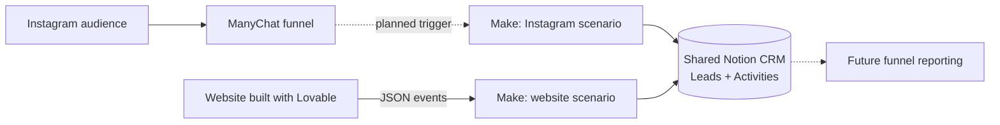
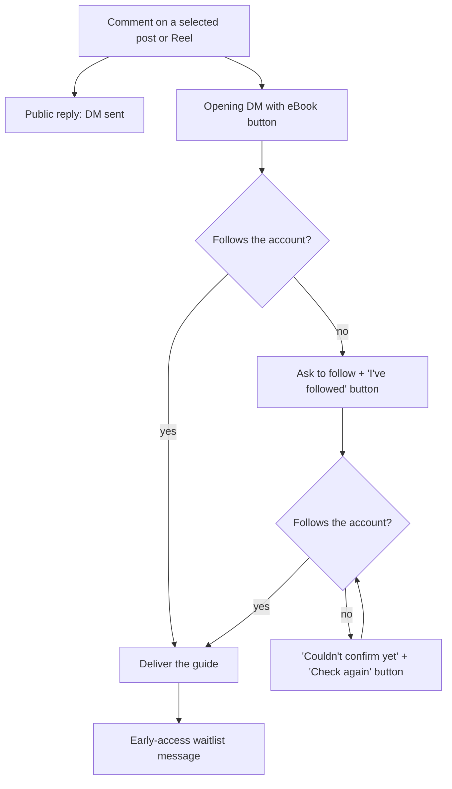
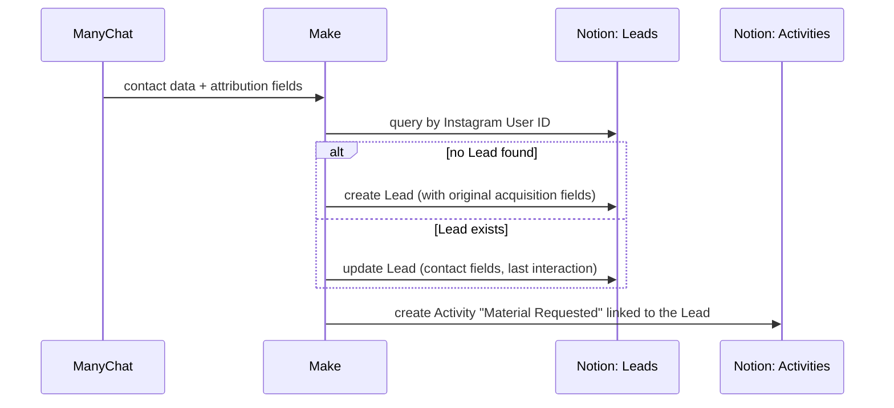
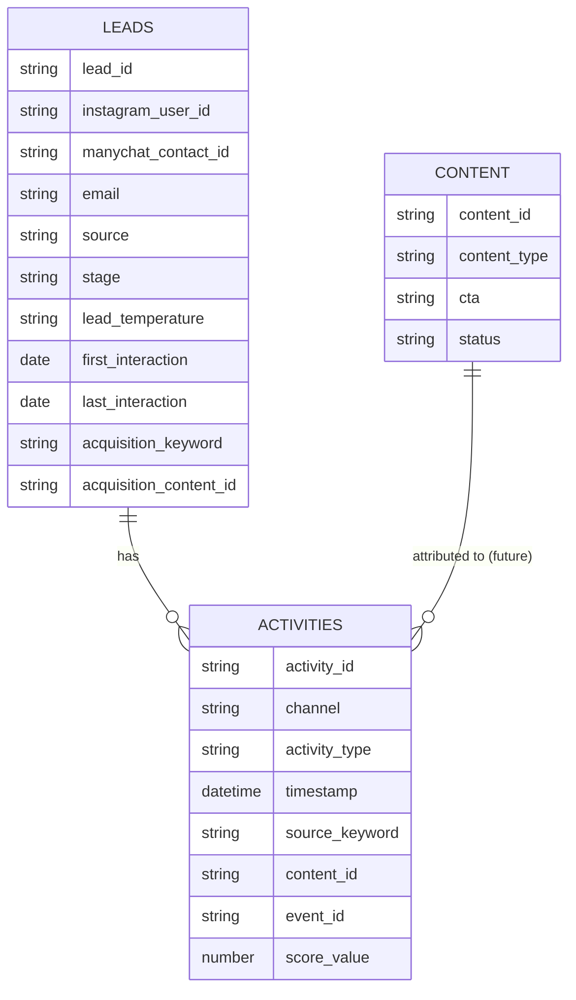

# Architecture and data model

## 1. Where this engine sits

Two ingestion paths write to one shared CRM. This repository covers the Instagram path; the website path is documented in the [Website-to-CRM Lifecycle Events Engine](https://github.com/giacomo-monti/website-to-crm-lifecycle-events-engine).

## 2. Conversational funnel (ManyChat)

**Design notes**

- The follow check runs twice: once when the person asks for the eBook, and again each time they confirm they have followed. Nobody is sent to a dead end.
- The public reply makes the interaction visible on the post, and the DM moves the conversation to a private, actionable channel.
- The waitlist message comes after the value has been delivered, never before.

## 3. CRM sync (Make → Notion)

- **Identity key:** Instagram User ID. The ManyChat Contact ID is stored as a secondary identifier. No email is required to create or match a Lead.
- **Attribution:** ManyChat custom fields carry a trigger keyword and a content ID (e.g. a Reel code). They become the Lead's *original acquisition* fields on creation and are copied onto every Activity.

## 4. CRM data model (shared with the website engine)

Simplified view: key fields only.

- **Leads** represent the person. **Activities** represent every touchpoint and lifecycle event. One Lead has many Activities.
- **Stage** and **Lead Temperature** (Cold, Warm, Hot, Customer) give the sales view; Activities give the history behind it.
- The **Content** database is kept for future content-level attribution. Today the content ID is stored as text on Leads and Activities.
- **Score Value** is a configured weight per Activity (currently 1), not a validated predictive scoring model.
